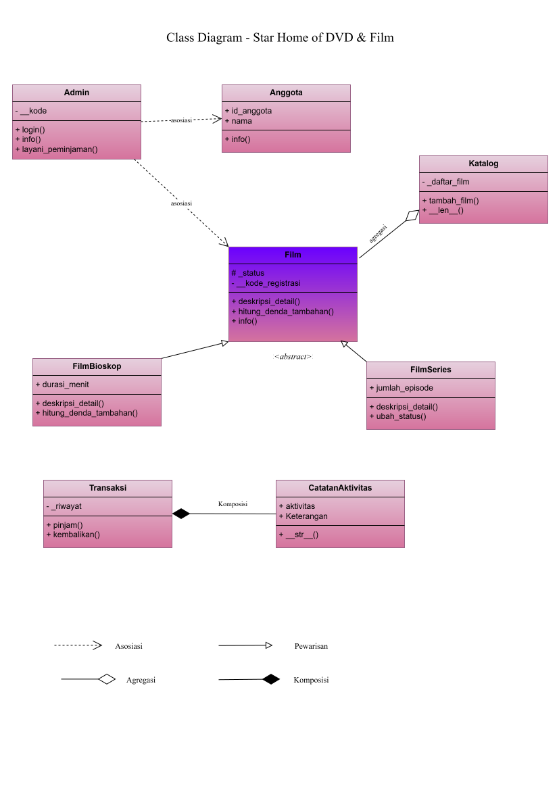
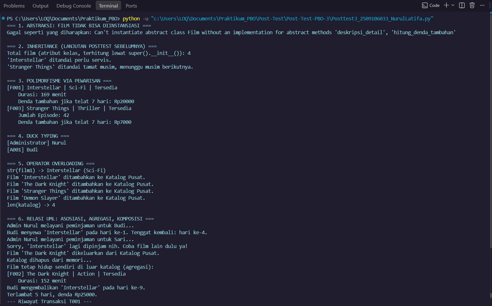
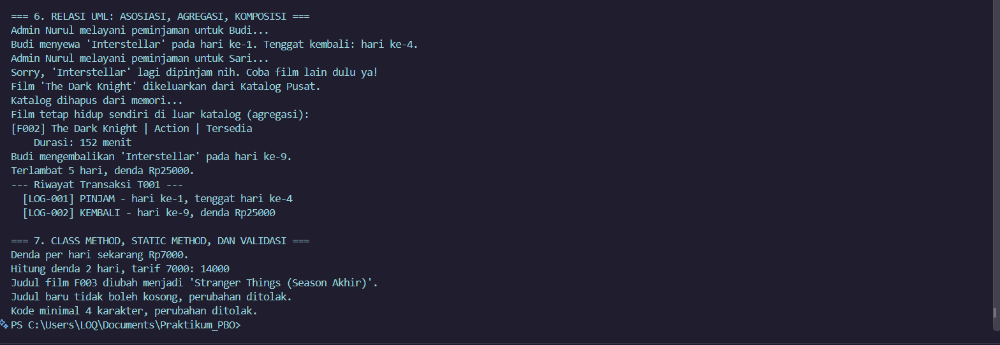

# Star Home of DVD & Film

Posttest 3 PBO (Python) - Abstraksi, Polimorfisme, dan Relasi UML. Lanjutan dari posttest 1 dan posttest 2.

**Cara menjalankan**

    python posttest3_2509106033_Nurullatifa.py

Program langsung menampilkan demonstrasi pengujian di terminal.

**Gambaran program**

Masih tema yang sama: katalog film, anggota, admin, dan transaksi sewa-kembali dengan denda otomatis. Di posttest ini `Film` diubah menjadi abstract class, dan perbedaan perilaku antar jenis film (bioskop vs series) ditentukan lewat method yang di-override, bukan lewat percabangan `if`/`elif` yang mengecek jenis objek.

**Class Diagram**

- **Asosiasi** - `Admin` ke `Anggota` dan `Admin` ke `Film`: method `layani_peminjaman()` menerima `Anggota` dan `Film` hanya sebagai parameter, tidak disimpan sebagai atribut tetap milik `Admin`.
- **Agregasi** - `Katalog` ke `Film`: `Katalog` menampung daftar `Film` yang dibuat di luar dirinya. Dipilih agregasi (bukan komposisi) karena `Film` tetap berarti dan tetap bisa dipakai walau objek `Katalog`-nya dihapus, dibuktikan di bagian 6 program.
- **Komposisi** - `Transaksi` ke `CatatanAktivitas`: `Transaksi` membuat `CatatanAktivitas` sendiri di dalam `pinjam()` dan `kembalikan()`. Dipilih komposisi karena `CatatanAktivitas` tidak punya arti dan tidak pernah dibuat di luar `Transaksi` pemiliknya.
- **Pewarisan** - `FilmBioskop` dan `FilmSeries` adalah jenis dari `Film`.

**Abstraksi**

`Film(ABC)` menjadi superclass abstrak dengan dua `@abstractmethod`: `deskripsi_detail()` dan `hitung_denda_tambahan()`. `info()` jadi method konkret yang dipakai bersama semua subclass, tidak perlu ditulis ulang. `FilmBioskop` dan `FilmSeries` wajib mengimplementasikan kedua abstract method tersebut dengan isi berbeda. Mencoba membuat `Film(...)` langsung akan menghasilkan `TypeError`, dibuktikan di bagian 1 program lewat `try`/`except`.

Konsep posttest sebelumnya tetap dipakai: `super().__init__()` di kedua subclass, atribut unik tiap subclass (`durasi_menit`, `jumlah_episode`), atribut protected `_status`, dan atribut private `__kode_registrasi`.

**Polimorfisme**

- **Lewat pewarisan**: `deskripsi_detail()` dan `hitung_denda_tambahan()` di-override berbeda oleh `FilmBioskop` dan `FilmSeries`, dipanggil lewat satu loop berisi objek campuran kedua subclass (bagian 3). `hitung_denda_tambahan()` juga benar-benar dipakai di `Transaksi.kembalikan()` untuk menambah denda, bukan sekadar demo.
- **Duck typing**: `Admin` dan `Anggota` tidak berhubungan lewat pewarisan, tetapi sama-sama punya method `info()`. Fungsi `tampilkan_info()` memanggil keduanya tanpa tahu tipe aslinya (bagian 4).
- **Operator overloading**: `Film.__str__()` membuat `str(film)` menampilkan judul dan genre; `Katalog.__len__()` membuat `len(katalog)` mengembalikan jumlah film di dalamnya (bagian 5).
- Tidak ada percabangan `if`/`elif` yang mengecek `type()` atau string jenis untuk membedakan perilaku di manapun dalam program ini.

**SOLID (Open/Closed Principle)**

Struktur abstraksi `Film` sudah otomatis menerapkan OCP: menambah jenis film baru (misalnya `FilmAnimasi`) cukup dengan membuat subclass baru yang mengimplementasikan `deskripsi_detail()` dan `hitung_denda_tambahan()`, tanpa mengubah kode `Film`, `FilmBioskop`, `FilmSeries`, `Transaksi`, atau `Katalog` yang sudah ada dan sudah teruji.

**Panduan pengujian**

Jalankan program, lalu perhatikan 7 bagian output:

1. Abstraksi: `Film(...)` dicoba langsung, menghasilkan `TypeError`.
2. Inheritance lanjutan: `super().__init__()`, atribut protected `_status` diubah langsung lewat `tandai_rusak()`, override `ubah_status()` pada `FilmSeries`.
3. Polimorfisme lewat pewarisan: loop film campuran, `deskripsi_detail()` dan `hitung_denda_tambahan()` berbeda tiap jenis.
4. Duck typing: `tampilkan_info()` dipanggil ke `Admin` dan `Anggota`, keduanya punya `info()` sendiri-sendiri tanpa pewarisan.
5. Operator overloading: `str(film)` dan `len(katalog)`.
6. Relasi UML: asosiasi lewat `layani_peminjaman()`, agregasi dibuktikan dengan menghapus `Katalog` lalu `Film` tetap hidup, komposisi lewat `cetak_riwayat()` yang isinya `CatatanAktivitas` buatan `Transaksi` sendiri.
7. Class method `ganti_denda()`, static method `hitung_denda()`, dan validasi data (judul kosong, kode admin kurang dari 4 karakter).

**Screenshot output**

Ini pas bagian paling atas dijalanin, kelihatan `Film(...)` langsung ditolak sama Python waktu dicoba dibuat, keluar `TypeError` kayak yang diminta soal.

Ini sisanya, dari bagian 2 sampai akhir, semua jalan normal sesuai yang udah dijelasin di atas.